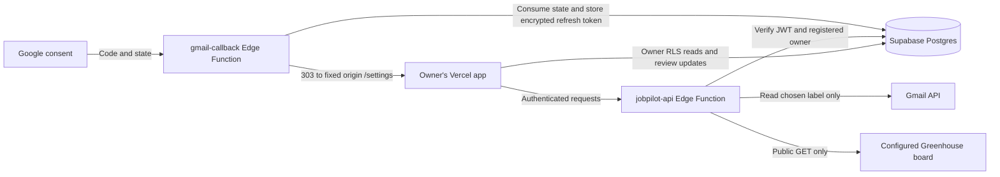

# Phase 3: read-only Gmail and job discovery

Phase 3 extends the existing owner registration, password login, profile, private
resumes, URLs, and PWA. It adds read-only Gmail consent, one confirmed Gmail label,
explicit Greenhouse boards, manual jobs, import history, deterministic ranking,
and save/dismiss/review state. There is no sending, application submission,
follow-up, paid AI, background sync, or Cron scheduling. Applications stays empty.

## Implementation and trust boundaries



- Both function entry points set `verify_jwt = false` in `supabase/config.toml`.
  The API **explicitly** calls Auth `getUser(bearer)` and checks administrator
  registration for every action. This supports publishable keys/current signing
  keys without relying on the legacy gateway JWT check. The callback cannot have
  a Supabase bearer header; its authorization is the pending, owner-bound state.
- 32-byte random state is stored only as SHA-256, expires after ten minutes, and
  is consumed by an atomic DELETE before code exchange. PKCE S256 binds the code.
  A new connection or disconnect invalidates older generations. The callback
  cannot choose a return URL: it redirects to the configured app origin.
- Gmail `users.getProfile` returns the mailbox address under `gmail.readonly`.
  Therefore no extra `openid`, `email`, or `profile` permission is needed. Exact
  case-insensitive address comparison is used; aliases/dot variants are not
  silently treated as equivalent. Settings configures this address separately
  from the existing login and profile contact email.
- Only `gmail.readonly` is requested, with offline access and explicit consent.
  Tokens are exchanged in the callback and refresh tokens are encrypted with
  AES-256-GCM, a fresh 96-bit IV, and owner ID as authenticated additional data.
  State and ciphertext tables have RLS and no browser/anonymous privileges.
  Access tokens exist only during backend requests; each operation obtains a
  fresh access token. Revocation/invalid grants change status to Reconnect required.
- Connected means last successfully verified with Google, with that date shown.
  A page reload reads saved status; **Check Gmail access** contacts Google. Outages
  produce visible errors without falsely claiming revoked access. Revocation
  cannot be known until an operation checks Google; there is no background poll.
- Disconnect deletes credentials and pending states, retains imported records,
  and does not itself revoke Google's grant. Google Account → third-party
  connections can revoke that grant separately. Reconnect replaces the old grant
  in JobPilot immediately; cancelled consent requires reconnecting again.
- The browser renders descriptions as escaped plain text. Backend HTML flattening
  removes markup; no `dangerouslySetInnerHTML`, remote image rendering, scripts,
  or HTML injection is used. URLs are validated as http(s) without credentials.
  Provider input is data, never executable instructions or configuration.
- No logs contain message bodies, OAuth codes, or tokens. Do not add request-body
  or callback-query logging to proxies/functions. Hosting providers may retain
  standard request metadata; restrict access to those logs.

Official references: [Google web-server OAuth](https://developers.google.com/identity/protocols/oauth2/web-server),
[Gmail identity and allowed scopes](https://developers.google.com/workspace/gmail/api/reference/rest/v1/users/getProfile),
[label-filtered message listing](https://developers.google.com/workspace/gmail/api/reference/rest/v1/users.messages/list),
[Greenhouse public Job Board API](https://docs.greenhouse.io/job-board.html),
[Supabase function authentication](https://supabase.com/docs/guides/functions/auth).

## Migration and API contract

New migration: `supabase/migrations/20261011000400_job_discovery.sql`.
It adds eight tables: `gmail_connections`, `gmail_credentials`,
`gmail_oauth_states`, `job_sources`, `import_runs`, `imported_jobs`, `job_origins`,
and `job_reviews`. It does not alter Phase 2 data or bootstrap another owner.
Authenticated users can only read their registered-owner rows and update their
own review fields. Backend RPCs are service-role-only, with a fixed empty search
path; foreign keys bind jobs, sources, and reviews to the registered owner.

`POST /functions/v1/jobpilot-api` accepts JSON and a Supabase user bearer token,
plus the normal public API key header. It returns JSON, uses `no-store`, and
accepts browser requests only from `JOBPILOT_APP_ORIGIN`.

| action | Additional JSON fields | Result |
| --- | --- | --- |
| `connect` | `email` | `{url}` for full-page Google consent |
| `check_gmail` | — | `{ok:true}` after refresh and mailbox verification |
| `disconnect` | — | `{ok:true}` after credential deletion |
| `labels` | — | `{labels:[{id,name}]}` for custom labels only |
| `save_gmail_label` | `labelId` | `{ok:true}` after checking current mailbox labels |
| `add_greenhouse` | `board` | `{ok:true}`; token is not a URL |
| `toggle_source` | `sourceId`, `enabled` | `{ok:true}` |
| `import` | `sourceId` | `{added,duplicates,more}` |
| `manual` | `url` and/or `description`; optional `title`, `company`, `location`, `work_mode` | `{added}` |

Failures return `{error: safe_code}` with 401 for failed authentication, 403 for
non-owner authorization, and 400 for action/provider failures. Error messages in
the UI describe recovery; provider payloads are not exposed. GET callback returns
303 to `/settings?gmail=<safe-result>`; that query is only a notice and never
changes the displayed connection state. Database state is authoritative.

## Import and matching behavior

- Create **JobPilot/Alerts** in Gmail and label the messages you want imported.
  Settings → Load Gmail labels → select → Confirm label. No default mailbox scan
  occurs. Changing label resets its cursor; changing mailbox pauses the old source
  until you reconfirm a label. Gmail content is fetched only for messages returned
  under the selected label, then label membership is checked again on each message.
- One import processes at most ten Gmail messages or fifty Greenhouse jobs, with
  a persisted cursor and a **Continue import** button. Import again after completing
  all pages to pick up new alerts/jobs. No schedule or automatic provider poll runs.
- Imports are serialized per source. A five-minute stale run is marked interrupted
  when retried. Refresh status after a timeout; partial writes are preserved, and
  retry deduplicates them. Successful page imports update last-success time. An
  import with more pages is explicitly marked by Continue import.
- Source IDs and normalized URLs prevent repeats. URL normalization removes known
  section anchors and tracking parameters, sorts query parameters, and preserves
  job-identifying fragments and path case. Same canonical URL shares a job while retaining all provenance.
  Repeated source IDs do not overwrite the first imported description or review.
  Existing jobs are snapshots; closed/edited listings are not automatically updated.
- Cross-source duplicates are only suggested for equal known title, company, and
  location among loaded jobs. They are never merged by fuzzy title similarity.
- Conservative alert parsing recognizes explicit `Title:`/`Job title:`, `Company:`,
  `URL:`/`Job URL:`, `Location:`, `Work mode:`, and `Required skills:` fields.
  Multiple blocks must each have an unambiguous title, company, and URL. Otherwise
  the whole alert becomes one uncertain review record. Most free-form newsletters
  will initially need review. Use their original source links and add confirmed
  individual jobs manually. Attachments are not read; large content is bounded.
- Sender, original Gmail message ID, received date, and source link are retained.
  Greenhouse dates are board update dates, not guaranteed posting dates. Missing
  salary, location, company, application address, or eligibility is never invented.
- Ranking uses saved profile values with trimmed, case-insensitive exact comparison:
  skill coverage 0–50, target title 25, work mode 15, location 10. Skills require an
  explicit `Required skills:` list; prose mentions are not qualifications. Missing
  means absent from the saved profile, not proof the owner lacks the skill. Unknowns
  receive zero; salary, experience, employment type, availability and eligibility
  are visibly unassessed. A score is preference overlap, not an acceptance prediction.
- Jobs initially loads the newest 100 records; filters, sorting, and duplicate
  suggestions operate on loaded jobs. Load more to include older records.
  Mark reviewed preserves uncertainty, and save/dismiss never creates applications.
- Manual URL entry never fetches the destination. No LinkedIn, Indeed, or unsupported
  site automation exists. Clicking an original link is an ordinary user navigation.

## Google Cloud and backend setup

Keep the current Supabase password login and Auth provider configuration unchanged.

1. In your Google Cloud project, enable **Gmail API**. Create a dedicated **Web
   application** OAuth client for this separate read-only connection. Configure
   Google Auth Platform branding, audience, support email, and your production app
   URL. For External/Testing, add only your intended Gmail account as a test user.
2. Add only `https://www.googleapis.com/auth/gmail.readonly` under Data Access.
   This is a restricted Gmail scope. Follow Google's consent/verification policy
   for your audience; do not assume personal use exempts every requirement.
   External/Testing grants with Gmail scopes generally expire after seven days;
   this is expected to show Reconnect required, not a scheduling failure.
   See [Google refresh-token expiry rules](https://developers.google.com/identity/protocols/oauth2#expiration).
3. Set this exact **Authorized redirect URI** for the existing linked project:

   ```text
   https://effwfngwrotkvhmzicno.supabase.co/functions/v1/gmail-callback
   ```

   No trailing slash. This is the Edge Function callback, not Supabase Auth's
   `/auth/v1/callback` or Vercel `/settings`. If you intentionally change projects,
   recompute as `<SUPABASE_URL>/functions/v1/gmail-callback`. Redirects on phones
   use exactly the same HTTPS URI. Authorized JavaScript origins are not needed
   for a backend authorization-code exchange; no Google JS SDK is used.
4. Set these **Supabase Edge Function secrets**, never Vercel/Vite variables:

   | Secret | Value |
   | --- | --- |
   | `JOBPILOT_APP_ORIGIN` | Exact existing Vercel production HTTPS origin, no path/query |
   | `GOOGLE_CLIENT_ID` | Dedicated web OAuth client ID |
   | `GOOGLE_CLIENT_SECRET` | That client's secret |
   | `GMAIL_TOKEN_ENCRYPTION_KEY` | Random 32-byte base64url key |

   Supabase supplies `SUPABASE_URL` and `SUPABASE_SERVICE_ROLE_KEY` in the runtime.
   Keep the encryption key in a secure backup; losing/changing it requires reconnect
   for existing credentials. Rotation is not automatic. Generate the key locally:

   ```powershell
   node -e "console.log(require('node:crypto').randomBytes(32).toString('base64url'))"
   ```

   Put the four values in a local ignored `.env.phase3.local` file, or use Supabase's
   secret editor. Never paste secrets into source, test fixtures, screenshots, or chat.
   Use a separate backend/client for previews; the API and callback allow one origin.

## Deployment commands — administrator run after review

No hosted migration or deployment is performed by implementation/testing. Back up
the hosted database and verify that the linked project is the intended one. Do not
rerun the Phase 2 bootstrap or alter owner registration.

```powershell
Get-Content .\supabase\.temp\project-ref
npx.cmd --no-install supabase migration list --linked
npx.cmd --no-install supabase db push --linked --skip-vault --dry-run
# Confirm the only pending migration is the reviewed Phase 3 migration.
npx.cmd --no-install supabase db push --linked --skip-vault
npx.cmd --no-install supabase secrets set --env-file .env.phase3.local --project-ref effwfngwrotkvhmzicno
npx.cmd --no-install supabase functions deploy jobpilot-api --project-ref effwfngwrotkvhmzicno
npx.cmd --no-install supabase functions deploy gmail-callback --project-ref effwfngwrotkvhmzicno
npm.cmd run lint
npm.cmd test
npm.cmd run build
npm.cmd run verify:pwa
# Use the already-linked Vercel project and existing public Supabase variables.
vercel deploy --prod
```

Function JWT settings come from the committed config. Deploy the backend before the
frontend. For a rollout problem, restore the previous frontend and disable the two
functions while diagnosing; keep tables/data. Do not run the destructive Phase 2
rollback with Phase 3 installed: new foreign keys intentionally prevent dropping
owner registration. A data-deleting Phase 3 rollback requires separate review.

## Verification and hosted/phone acceptance

Local commands:

```powershell
npm.cmd run lint
npm.cmd test
npm.cmd run build
npm.cmd run verify:pwa
npx.cmd --no-install tsc --ignoreConfig --noEmit --strict --target es2023 --module esnext --moduleResolution bundler --allowImportingTsExtensions --skipLibCheck supabase/functions/_shared/service.ts
npx.cmd --no-install supabase start
npx.cmd --no-install supabase migration up --local
npx.cmd --no-install supabase test db --local
# Terminal 1:
npm.cmd run preview -- --host 127.0.0.1 --port 4173 --strictPort
# Terminal 2 (Windows Edge, or set JOBPILOT_BROWSER):
npm.cmd run test:browser
# Optional real local Edge/Auth/PostgREST checks, with fixture-only Google credentials:
# Create ignored .env.phase3-test.local containing JOBPILOT_APP_ORIGIN=http://127.0.0.1:4173,
# GOOGLE_CLIENT_ID=fixture-client, GOOGLE_CLIENT_SECRET=inert-fixture-secret, and a
# generated 32-byte GMAIL_TOKEN_ENCRYPTION_KEY. Never use your live Google secrets.
# Terminal 3:
npx.cmd --no-install supabase functions serve --env-file .env.phase3-test.local
# Terminal 2:
npm.cmd run test:discovery:local
```

Vitest and browser provider requests use synthetic fixtures and block real network
access. pgTAP tests run against local Postgres and roll back their synthetic rows.
None of these verifies live Gmail, production OAuth consent, Vercel, or a phone.
The optional local Edge check refuses to run if an owner is already registered,
uses local synthetic Auth accounts and jobs, and removes only its own fixtures.
Its callback exercises consent denial/replay without sending a Google request.

After deployment, perform these checks yourself on the hosted app and actual phone:

1. Existing login, direct `/jobs` and `/settings` reloads, profile, default resume,
   and private PDF downloads still work; a non-owner cannot use discovery.
2. Settings → enter your exact Gmail address → Connect Gmail → verify read-only
   consent, approve, return through the callback to the original Vercel origin.
   Check Connected and Last verified. Wrong account, denied consent, expired link,
   and callback replay must not connect a different account or reuse credentials.
3. Create/choose JobPilot/Alerts, load labels, and explicitly confirm it. Put known
   test alerts in it and keep a control message outside it. Import manually: only
   labeled alerts appear. Ambiguous multi-job alerts require review. Import twice:
   count stays stable, provenance stays intact, saved/dismissed state survives.
4. Confirm one Greenhouse token, import, follow the original link yourself. Confirm
   other boards and unsupported websites were not accessed by the importer.
5. Change profile preferences and save. Check explainable skill/title/location/mode
   scores, missing evidence, unknown qualification wording, filters, and review state.
6. Revoke the grant in Google Account, then Check Gmail access: Reconnect required.
   Reconnect and check again. Disconnect removes stored credentials and prevents new
   Gmail imports while retaining existing jobs. Simulate lost connectivity and retry
   imports after refresh; partial imports must not duplicate records.
7. On Android Chrome and iPhone Safari/installed mode, complete the same consent
   flow. OS/browser handoff may use a different browser session: sign in there if
   prompted, or return to the installed app and Refresh source status. Connection
   persistence is backend-owned, never tied to localStorage OAuth state.
8. At 360/375/390px, tablets, landscape, 200% zoom, and with a keyboard, verify form
   labels, wrapping, visible focus and errors, source/connection state, and touch
   actions. Verify app update remains a prompt, and offline private writes fail
   without caching data. Inspect Cache Storage: public assets only, no API/function
   responses, message bodies, credentials, or drafts.
9. Applications remains empty; no send permission, application email, follow-up,
   automatic submission, or scheduled job has been created.

Use only your own consented mailbox for the hosted checks. Do not send application
emails. Record live Gmail and phone results separately from mocked/local results.

## Implementation verification record — 2026-10-11

| Check | Result |
| --- | --- |
| `npm run lint` | Passed, no warnings |
| `npm test` | 93 tests passed across 9 files; fixtures and mocked providers only |
| `npm run build` | Passed; nonblocking warning for the approximately 549 kB main JS chunk (159 kB gzip) |
| `npm run verify:pwa` | Passed; 9 unique public assets, no private API/function caching, explicit update activation |
| `npm run check:edge` | Passed; shared backend TypeScript |
| Local Supabase migration | Applied only `20261011000400_job_discovery.sql` locally |
| `supabase test db --local` | 109 assertions passed across Phase 2 and Phase 3 |
| `npm run test:discovery:local` | Passed against actual local Edge runtime, Auth, and PostgREST with synthetic accounts; no Google request |
| `npm run test:browser` | Passed in actual headless Edge with mocked Supabase/provider responses at 360/375/390/768/1024/1440 and landscape |
| Visual review | Jobs and Settings screenshots inspected at 390 and 1440px; existing design retained |
| Mechanical UI detector | Existing palette-documentation advisories only; no new layout finding |
| Hosted migrations/deployment, live Gmail, actual phone OAuth handoff | Not performed; acceptance steps above remain required |

Security/code review covered state generation/consumption, wrong mailbox, revoked
tokens, backend-only credential access, import retries, label boundaries, owner
authorization, inert rendering, URL deduplication, and unknown qualifications.
Review fixes included column-limited review updates, generation-bound failure
status, preserving job-identifying URL fragments, avoiding URL truncation, and
requiring review for oversized alerts. Existing Phase 2 migrations and hosted
data were not changed. Local test fixtures were cleaned up. No Phase 4 work was added.
