# Phase 4 implementation plan

Preserve React/Vite, owner registration, imported jobs, private resumes, and the
existing encrypted Gmail credentials. No hosted operations or live sends during
implementation.

1. Correct divergent Edge dependency pins. Add an OAuth upgrade that leaves the
   active grant intact until fresh consent succeeds. Preserve readonly imports.
2. Add owner-only applications and service-only mutation RPCs with optimistic
   revisions, atomic send reservation, immutable sending snapshots, and explicit
   delivery-unknown recovery. Add local pgTAP isolation/state checks.
3. Extend the owner-checked API for draft editing, review, send, reconciliation,
   and external tracking. Build MIME/PDF entirely on the backend. Never retry a
   request that might have reached Gmail.
4. Replace the Applications placeholder with an accessible editor and final
   confirmation, linked from saved/reviewed jobs. Keep unsaved edits in memory.
5. Verify with synthetic recipients and mocked Gmail, existing frontend/PWA
   checks, local database and Edge checks, and phone-width browser checks.
6. Record exact results and administrator-only rollout/controlled acceptance.

## Implemented behavior

From Jobs, save or review an opportunity, then select **Create application draft**.
One application is retained per job; repeated create requests open the existing
record. Dismissed jobs must be restored before creating a draft. Imported jobs,
provenance, review fields, profile, and existing Gmail ciphertext are preserved.

The employer recipient starts empty, including for Gmail imports. Enter a single
application address from a trusted source and check its verification box. Changing
the address clears verification. The initial subject uses the recorded job title;
the body only expresses interest, mentions the selected attachment, and uses the
saved name when present. No qualifications, experience, salary, or contact addresses
are inferred. All fields remain editable. Select a ready private PDF explicitly.

**Save draft** persists private fields under owner RLS. Unsaved edits exist only in
React memory, with no localStorage, IndexedDB, service-worker, or offline write
queue. **Review final email** checks the PDF on the backend, records its SHA-256,
name and size, and freezes the sending mailbox generation. The review displays
From, To, subject, exact body, selected PDF metadata, and the actual outgoing file
name (`resume-<resume-id>.pdf`). PDF bytes never enter the application editor or its
state. Existing owner-initiated downloads remain available on Resumes.

The owner must check the final confirmation and press **Confirm and send email**.
Fresh Gmail sending consent is also required. Editing invalidates readiness;
changing/reconnecting the Gmail account requires editing and reviewing again.
The backend sends the stored revision, not a second email body supplied with the
send request. Gmail acceptance is recorded as Sent, not proof of delivery or reading.

From an editable draft, **Track an application sent outside JobPilot** records the
date and method of a submission the owner already made. Its status is explicitly
**Sent outside JobPilot**, with no fabricated Gmail message ID or JobPilot send claim.

## Database and send state machine

Migration: `supabase/migrations/20261012000500_applications.sql`.
It adds `applications`, owner SELECT RLS, composite owner/job and owner/resume
foreign keys, unique owner/job identity, and service-role-only mutation RPCs.
The browser cannot insert applications, change delivery status, or call those RPCs.
All writes go through authenticated `jobpilot-api` actions and `authorizeOwner`.
All privileged SQL uses a fixed empty search path. Existing migrations are unchanged.

```mermaid
stateDiagram-v2
  [*] --> draft: saved/reviewed job
  draft --> ready: verify recipient and PDF; review
  ready --> draft: save edits
  ready --> sending: confirm + atomic reservation
  sending --> sent: Gmail returns message ID
  sending --> failed: preflight failure or explicit Gmail rejection
  failed --> draft: owner edits and saves
  sending --> delivery_unknown: timeout / ambiguous response / interrupted execution
  delivery_unknown --> sent: owner confirms message in Gmail Sent
  draft --> external: owner records prior external submission
  ready --> external: owner records prior external submission
  failed --> external: owner records prior external submission
```



Every mutation includes the expected revision. `application_command` locks the row
and atomically changes Ready to Sending with a unique attempt ID. Concurrent taps,
tabs, delayed requests, and repeated POSTs cannot reserve the same revision twice.
The sending snapshot is immutable. The backend refreshes Google access, verifies
the mailbox and send scope, downloads the owner-bound PDF, checks its signature,
size and recorded SHA-256, and verifies the Gmail generation again before dispatch.
It builds UTF-8/base64 MIME with CRLF headers, a folded RFC 2047 subject, one To
address, no Cc/Bcc, an attempt-based Message-ID, and one PDF. Attachment content and
OAuth tokens remain backend-only. Provider payloads and credentials are not logged.

There is **no retry loop**. Definite pre-dispatch failures and explicit Gmail
400/401/403/404/413/429 rejection responses become Failed. The owner must save and
review again before any new attempt. Network errors after dispatch, 5xx responses,
unusable success responses, and response-body failures become Delivery unknown.
If the worker or database acknowledgement is lost, the reservation stays Sending;
an owner-triggered refresh after three minutes conservatively changes it to
Delivery unknown. No Cron or unattended process performs this transition or sends.

Unknown delivery is never unlocked for another initial send. The owner checks
Gmail Sent for mailbox, recipient, subject, and time; the UI also provides the
`rfc822msgid:<attempt-id>@jobpilot.invalid` search. A negative search can be recorded
but does not prove non-delivery. A positive manual reconciliation records the
owner's note/time and marks Sent without inventing a provider message ID. A crash
before provider dispatch can therefore remain conservatively unknown; this is an
intentional tradeoff against duplicate applications. There is no exactly-once
transaction spanning Gmail and Postgres, and the MIME Message-ID is a reconciliation
aid, not a Gmail idempotency guarantee.

Referenced resumes are retained. A restrictive Storage deletion policy protects
their objects, and the composite FK protects metadata. For an editable application,
clear/change its resume and save before deletion. Sent/history attachments remain
pinned. Storage API removal is used for cleanup; no protective trigger is disabled.

## OAuth and configuration correction

The prior per-function `deno.json` files floated Supabase JS at `@2`; both are now
pinned to `2.117.3`, matching the shared backend import map. The application still
uses the existing two production functions and their committed `verify_jwt=false`
configuration. The API explicitly verifies the bearer token through Auth and checks
owner registration; the OAuth callback authorizes through single-use owner-bound
state/PKCE. There is no new production function to configure or deploy.

The normal **Connect/Reconnect Gmail** flow still requests only `gmail.readonly`.
**Enable Gmail sending / renew consent** requests exactly `gmail.readonly` plus
`gmail.send`, with offline access and `prompt=consent select_account`. No compose,
modify, full-mailbox, OpenID, or profile permission is added. Google may return an
existing send scope on a read-only grant; that does not enable sending because the
connection also requires a successful explicitly requested sending consent timestamp.

The callback checks actual returned scopes and exact mailbox identity before
committing. Missing either required scope fails the sending upgrade. Refresh
responses are checked when they include `scope`; OAuth omission means the original
grant's scopes, whose successful consent is stored on the backend. Google still
enforces access on every provider request. Invalid grants/mismatched scopes require
reconnection; provider outages do not silently erase the credential.

New v4 OAuth RPCs keep the active connection and encrypted credential until the
new callback succeeds. Denied, expired, superseded, and wrong-account attempts do
not delete the working connection. Successful consent atomically replaces its
generation/credential/scopes. A different mailbox pauses the old label source until
the owner reconfirms a label. Disconnect clears both credentials and pending consent,
while retaining jobs and application history. No token-encryption key rotation is
needed or performed. Legacy RPCs remain for rollout compatibility but are not used
by the new backend.

Official contracts used: [Google sending/MIME guide](https://developers.google.com/workspace/gmail/api/guides/sending),
[users.messages.send](https://developers.google.com/workspace/gmail/api/reference/rest/v1/users.messages/send),
and [web-server OAuth and granted scopes](https://developers.google.com/identity/protocols/oauth2/web-server).

## API additions

All actions use the existing authenticated `POST /functions/v1/jobpilot-api`.
Responses are `no-store`, same-origin CORS, and safe error codes. Application actions
return the application row, without credentials or PDF bytes.

| Action | Fields |
| --- | --- |
| `connect_send` | `email`; returns a fresh Google consent URL |
| `application_create` | `jobId`; idempotently opens the job's draft |
| `application_save` | `id`, `revision`, `recipient`, `recipient_verified`, `subject`, `body`, nullable `resume_id` |
| `application_ready` | `id`, `revision`; verifies and hashes the backend PDF |
| `application_send` | `id`, `revision`, `confirmed: true` |
| `application_refresh` | `id`, `revision`; conservatively resolves stale Sending |
| `application_reconcile` | `id`, `revision`, `outcome: sent or not_found`, `note` (10–2000 characters) |
| `application_external` | `id`, `revision`, `sent_at` (past ISO timestamp), `note` |

## Local verification commands

Only synthetic `example.invalid` recipients and mocked Google are used. Frontend
tests mock Supabase and prohibit real network requests. Browser tests intercept all
provider requests and inspect a local production build. They are not live Gmail,
hosted Supabase, actual-phone, Safari, or screen-reader acceptance tests.

```powershell
npm.cmd run lint
npm.cmd test
npm.cmd run build
npm.cmd run verify:pwa
npm.cmd run check:edge
npx.cmd --no-install supabase start
npx.cmd --no-install supabase migration up --local
npx.cmd --no-install supabase test db --local
npm.cmd run prepare:edge:local
# Terminal 1: fixture configuration only, never production Google secrets
npx.cmd --no-install supabase functions serve --env-file .env.phase4-test.local --no-verify-jwt
# Terminal 2: run serially; each uses and removes a temporary local owner
npm.cmd run test:discovery:local
npm.cmd run test:applications:local
# Terminal 3:
npm.cmd run preview -- --host 127.0.0.1 --port 4173 --strictPort
# Terminal 2:
npm.cmd run test:browser
```

`prepare:edge:local` creates ignored inert secrets and an ignored `phase4-fixture`
function. Its source is `scripts/fixtures/application-edge.ts`. It invokes the same
production handlers with a fixed mock transport, fails outside local Supabase or
without the fixture client ID, and blocks unexpected routes/real recipients. There
is no production test-mode switch. Never deploy this fixture; deploy only the two
explicit names below. Stop local serving after verification. Both local integration
scripts refuse to touch an already registered owner and remove only their synthetic
rows/accounts; application cleanup uses the Storage API for its private PDF.

## Hosted rollout — administrator steps, not performed

1. Back up the existing database. Confirm the linked project and current Phase 3
   migration state. Do not rerun owner bootstrap, reset the database, disconnect
   Gmail, regenerate the encryption key, or run old destructive rollback scripts.
2. In the **existing Google Cloud OAuth project**, Google Auth Platform → **Data
   Access**: keep `https://www.googleapis.com/auth/gmail.readonly` and add
   `https://www.googleapis.com/auth/gmail.send`. Keep the existing audience/test
   user and Gmail API configuration. Review Google's consent requirements for your
   audience. Keep this exact Web-client authorized redirect URI:

   `https://effwfngwrotkvhmzicno.supabase.co/functions/v1/gmail-callback`

3. Keep the existing Supabase secrets: `JOBPILOT_APP_ORIGIN`, `GOOGLE_CLIENT_ID`,
   `GOOGLE_CLIENT_SECRET`, and especially `GMAIL_TOKEN_ENCRYPTION_KEY`. Check their
   presence in the dashboard without copying values into logs or chat. No new
   production secret or Vite variable is required.
4. Review the dry run. The only new pending migration for an up-to-date Phase 3
   installation must be `20261012000500_applications.sql`. Apply it, redeploy **both**
   existing Edge Functions, then deploy the frontend to the existing Vercel project:

   ```powershell
   Get-Content .\supabase\.temp\project-ref
   npx.cmd --no-install supabase migration list --linked
   npx.cmd --no-install supabase db push --linked --skip-vault --dry-run
   # Stop if the linked project or pending migrations differ from the reviewed plan.
   npx.cmd --no-install supabase db push --linked --skip-vault
   npx.cmd --no-install supabase functions deploy jobpilot-api --project-ref effwfngwrotkvhmzicno
   npx.cmd --no-install supabase functions deploy gmail-callback --project-ref effwfngwrotkvhmzicno
   npm.cmd run build
   npm.cmd run verify:pwa
   vercel deploy --prod
   ```

   Use named function deploys; never deploy all functions from a test workspace.
   Do not apply migrations or deploy from this implementation session.
5. In the hosted app, verify existing login, profile, resumes, imported jobs, source
   label and a manual read-only import still work. Existing Gmail grants must not
   enable Send automatically. Check direct `/applications` reload and PWA updates.
6. Settings → verify your exact Gmail address → **Enable Gmail sending / renew
   consent**. Complete fresh Google consent for reading and sending. Check the
   stored sending-consent notice and **Check Gmail access**. Denied/cancelled
   consent should leave imports working. Then edit/save/review any pre-consent
   draft so the final From account reflects the new connection generation.
7. On an actual phone, verify the full review at 360/375/390px, keyboard navigation,
   zoom, checkbox/confirmation, online/offline handling, and OAuth handoff from
   installed mode. Confirm private API/function responses and drafts never appear
   in Cache Storage. These actual-device checks remain administrator acceptance.

Rollout recovery: restore the previous frontend, disable manual sending through
the UI/backend while investigating, and retain the migration/data. A previous
backend cannot understand the new application states. Never roll back by dropping
application tables or resetting Gmail credentials. Disconnect prevents future
reservations but cannot recall a request already dispatched to Gmail.

## One controlled live-send acceptance test — owner only, after rollout

This test has **not** been performed. Do not use a real employer address.

1. Create one clearly labelled test job, save/review it, and create its draft. Use
   one recipient address **you own**, enter it manually and verify it. Use a benign
   test PDF and a unique subject such as `JobPilot acceptance YYYY-MM-DD HHmm`.
2. Complete sending consent as above. Save, review the exact From/To/subject/body
   and attachment, check the final confirmation, and press Send **once**.
3. Confirm one Sent record with a Gmail message ID and matching email in Gmail
   Sent and your recipient inbox. Open the received attachment and compare it
   with the selected test PDF. Record time, message ID, and result privately.
4. Refresh the app; the record must remain Sent with no Send control. Do not send
   a second test to exercise duplicates; duplicate submission is verified locally.
5. If status is Sending or Delivery unknown, stop. Refresh after three minutes and
   reconcile in Gmail manually using the provided search. Do not resend. Record
   the outcome using the reconciliation UI. Inbox absence alone is not proof of
   failure.

No automatic sends, Cron, follow-ups, website form submission, LinkedIn/Indeed
automation, or live employer applications are enabled by this phase.

## Verification record — 2026-10-12 / final browser check 2026-10-13

| Check | Exact final result |
| --- | --- |
| `npm run lint` | Exit 0; no warnings or errors |
| `npm test` | 130 passed across 11 files; synthetic/mocked providers only |
| `npm run build` | Exit 0; main JS 565.73 kB, gzip 162.62 kB; nonblocking >500 kB chunk warning |
| `npm run verify:pwa` | Exit 0; 9 public precache assets, navigation-only fallback, no API/runtime caching, explicit update activation |
| `npm run check:edge` | Exit 0; shared backend TypeScript passed |
| `supabase start` | Local Docker stack started; Docker initially stopped, then started successfully |
| `supabase migration up --local` | Applied only `20261012000500_applications.sql` locally |
| `supabase test db --local` | PASS; 158 assertions across 3 SQL files, including existing Phase 2/3 checks |
| `npm run test:discovery:local` | Exit 0; real local Edge/Auth/PostgREST, synthetic accounts, no Google requests |
| `npm run test:applications:local` | Exit 0; real local Edge/Auth/PostgREST/Storage with injected mocked Google; concurrent reservation, Gmail ID, rejection, timeout, fresh consent/replay/cancellation, missing PDF, pinned deletion and external tracking passed |
| `npm run test:browser` | Exit 0; headless Edge at 360/375/390/768/1024/1440px and 932×360 landscape; draft/review, final confirmation, duplicate taps, uncertain-send lock, status screens, touch targets and public-only caches passed |
| UI mechanical detector | Exit 1 for 16 existing CSS palette-documentation advisories; no new layout finding; run once |
| `git diff --check` | Passed; Git noted repository CRLF conversion notices |
| Local fixture cleanup | Local owner registrations, applications and Gmail credentials all 0 after integration cleanup; test accounts/PDF removed |
| Hosted migration/deployment, actual phone/Safari, live Gmail or live-send acceptance | Not performed |

The in-app browser was unavailable after setup/discovery, so browser verification
used the repository's existing headless Edge harness. Screenshots are in
`artifacts/application-editor-{390,1440}.png` and
`artifacts/application-review-{390,1440}.png`. They contain only synthetic fixtures.

Security/code review covered owner authorization, RLS and restricted RPC privileges,
scope upgrade and credential preservation, MIME header injection and UTF-8 encoding,
owner-bound private PDFs, revision conflicts/concurrent sends, ambiguous delivery,
manual provenance, and browser privacy. Review found and fixed two interaction bugs:
unchanged-revision refresh now discards confirmed unsaved edits, and a failed send
request locks confirmation until status refresh, including after closing/reopening
the application. Regression tests exercise both. Status transitions restore focus.

Independent interface review disposition: **ship**.

| Finding | Final verdict |
| --- | --- |
| Send re-enabled after uncertain failure | Resolved; lock survives back/reopen and successful refresh requires new confirmation |
| Refresh failed to discard unchanged-revision edits | Resolved; independent editor reset with regression coverage |
| Keyboard focus after mutations | Resolved; status heading/final review focus restored |

All four recaptured screenshots were reviewed. No open material findings remain
from that interface review; its behavioral verdict used source and test inspection,
not an independent rerun. The temporary local Edge server and Vite preview were
stopped, and the generated `phase4-fixture` directory and inert `.env.phase4-test.local`
were removed after testing. `prepare:edge:local` regenerates them for future local
checks. The local Supabase database remains available.
