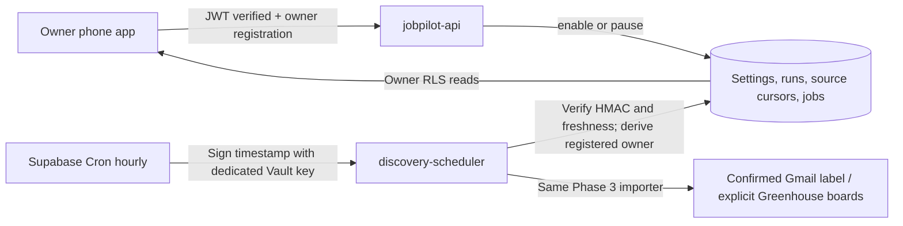

# Phase 5: owner-controlled scheduled discovery

Implementation is local only. No hosted migrations, deployments, Cron jobs, Gmail
reads, or real email sends were performed. Automation defaults **OFF** (including
when its settings row does not yet exist). Phase 4 application review, fresh sending
consent, explicit send, and unknown-delivery reconciliation remain owner-triggered.

## Contract and boundaries

Settings → Automation (`/settings/automation`) provides Enable/Pause, the hourly
schedule in **Asia/Manila / Philippine time / PHT (UTC+8)**, last run, next expected
run, per-source results, and recovery instructions. Each hour is on minute 00;
there is no configurable browser timezone or schedule editor. Resume starts at the
next hour. The screen says “expected”, never claims that a Cron job exists merely
because the owner enabled discovery, and flags a check over ten minutes overdue.

The dashboard shows five recent jobs and five recent import runs. Jobs and
discovery status refresh every 30 seconds while visible and online, and on focus
or return to the foreground. Private responses remain network-only. Unsaved profile
and application drafts remain in memory; PWA update prompting is unchanged.



`POST /functions/v1/discovery-scheduler` has `verify_jwt=false`, but authenticates
every call itself using **JOBPILOT_SCHEDULER_SECRET**, a dedicated 43–128 character
base64url signing key. Cron sends `Authorization: Bearer <unix-seconds>.<hex-HMAC>`.
HMAC-SHA256 signs the exact UTF-8 string `jobpilot-discovery-v1:<unix-seconds>` using
the UTF-8 secret string as the key. Web Crypto verifies the signature; timestamps
older than 300 seconds or more than 30 seconds in the future are rejected. User
JWTs, raw scheduler secrets, publishable keys and service-role JWTs do not authorize
it. Missing configuration fails closed (503);
wrong credentials return 401; other methods return 405. There is no browser CORS
permission. Request bodies are ignored: caller-supplied owner IDs, sources and
application actions have no effect. Secrets/tokens/provider payloads are not logged.

Responses are `no-store`: `{status:"skipped"}` when off/not due/already running,
or `{status:"succeeded"|"partial"|"failed",run_id}` for a completed attempt.
Provider failure can return HTTP 200 with failed run status; inspect run records,
not just HTTP status. Worker/database/configuration failures return safe errors
with HTTP 503. No immediate provider retry loop exists. Failed imports retain the
last committed cursor and retry on a later scheduled turn; deduplication protects
already stored jobs. Gmail invalid grants/401s show **Reconnect required** and a
failed import, without deleting jobs or credentials. A provider outage is not
misreported as a revoked grant.

The owner API adds only `{action:"set_automation",enabled:boolean}`. It verifies
the user with Auth and `phase3_is_owner`; the owner argument to the database comes
from that verification. The browser has SELECT-only RLS access to automation
settings/history and no execute privilege on worker RPCs or Vault.
pg_net's managed request queue is readable by database roles and its grants cannot
be revoked by the project postgres administrator. Therefore the signing secret
**never enters the queue or request**. Only a short-lived, purpose-bound signature
does. A replay within its five-minute window can only attempt the same discovery
operation: owner/source selection stays server-side and the atomic hourly claim
prevents a second run. Keep net/Vault outside Data API exposed schemas and never
log authorization headers. Vault and dispatch RPCs are inaccessible to browser
roles. The local Cron check verifies the actual Postgres signature against Node's
HMAC, and verifies the secret is absent from the queue, inside a rolled-back transaction.

## Migration and run control

New migration: **20261013000600_discovery_automation.sql**. Existing migrations
are unchanged. It adds `discovery_automation`, `automation_runs`, an optional
`import_runs.automation_run_id`, indexes, and service-role-only RPCs. It does not
bootstrap an owner, create Cron, alter applications, or remove hosted records.
The `latest_scheduled_imports` security-invoker view retains a result per source
beyond the 20-run recent-history window while applying the underlying owner RLS.

Label confirmation gains `job_sources.confirmed_email`. Existing enabled Gmail
sources inherit their currently configured mailbox. Previously paused Gmail
sources conservatively require label confirmation again. Switching the configured
mailbox invalidates confirmation and pauses the label. Normal reconnects to the
same mailbox preserve confirmation. A generic Enable source cannot bypass this.
The original label selection API still verifies available custom labels with Google.

Atomic claim locks the settings row, resolves the owner from administrator
registration, checks enabled/due, reserves a three-minute lease and advances the
next expected hour. The unique running-owner index prevents concurrent ticks;
the existing source lock also excludes simultaneous manual imports. The oldest
attempted enabled sources run first, with at most **three sources per tick**;
large source lists therefore rotate over multiple hours. No source is auto-added
or auto-enabled; manual entries are never scheduled.

The same importer keeps **10 Gmail messages / 50 Greenhouse jobs per source**,
label membership checks, provenance, canonical URL/external ID deduplication,
8 MB provider response caps, and ten-second request timeouts. The scheduler adds
a **100-second work deadline** and **40-provider-request ceiling** across sources.
Requests and every candidate write check current schedule/source state; database
writes are fenced by the run/lease and source lock. Each committed candidate also
updates server-side counts, so a crash cannot make committed imports disappear
from history. Provider work stops at the deadline, leaving bounded database
finalization time; the platform still enforces its own worker/CPU limit.

Pause invalidates the active run immediately. A dispatched read may finish, but
later writes are refused. Resume cannot revive an old worker. A crash leaves a
running record until the next authenticated tick expires the lease and marks it
and its source import interrupted. The UI identifies expired running records
before that recovery. Old workers cannot overwrite a newer cursor. On a mid-page
failure, the previous cursor stays in place: a later pass safely repeats that page.
After a full traversal the cursor clears and a later pass checks for new listings.
Greenhouse remains a bounded public GET of explicitly configured boards. Gmail
never performs an unfiltered inbox listing or requests sending access for discovery.

## Administrator hosted rollout — NOT performed

1. Back up hosted data. Verify the existing project reference and Phase 4 migration
   state. Keep the owner registration, Gmail grant, encryption key, private PDFs,
   jobs and applications. Do not bootstrap again, reset, or disconnect Gmail.
2. Generate a fresh dedicated random 32-byte base64url credential. Store it in a
   password manager. Keep the same value in Supabase Edge secrets and Vault;
   never use a `VITE_` variable, service-role key, Google secret, or login JWT.
   A local ignored secret file can be generated without printing its value:

   ```powershell
   node --input-type=module -e "import {randomBytes} from 'node:crypto'; import {writeFileSync} from 'node:fs'; writeFileSync('.env.scheduler.local', 'JOBPILOT_SCHEDULER_SECRET=' + randomBytes(32).toString('base64url') + '\n', {flag:'wx'});"
   # After approval only; this uploads exactly the new scheduler secret:
   npx.cmd --no-install supabase secrets set --env-file .env.scheduler.local --project-ref effwfngwrotkvhmzicno
   ```

   In the hosted dashboard **Vault**, create `jobpilot_scheduler_secret` with that
   exact value, and `jobpilot_project_url` with
   `https://effwfngwrotkvhmzicno.supabase.co`. Use Vault's secret editor, not a
   committed SQL literal. Restrict access to Vault, SQL, Edge secrets and logs.
   Do not print/query `decrypted_secret` values for monitoring. Securely remove the
   ignored temporary file after storing the credential. Retain existing
   JOBPILOT_APP_ORIGIN, GOOGLE_CLIENT_ID, GOOGLE_CLIENT_SECRET and
   GMAIL_TOKEN_ENCRYPTION_KEY unchanged. No new Google scopes are needed.
3. After explicit approval, review and apply only the new pending migration:

   ```powershell
   Get-Content .\supabase\.temp\project-ref
   npx.cmd --no-install supabase migration list --linked
   npx.cmd --no-install supabase db push --linked --skip-vault --dry-run
   # Stop if project or pending migrations differ from the reviewed plan.
   npx.cmd --no-install supabase db push --linked --skip-vault
   npx.cmd --no-install supabase functions deploy jobpilot-api --project-ref effwfngwrotkvhmzicno
   npx.cmd --no-install supabase functions deploy discovery-scheduler --project-ref effwfngwrotkvhmzicno
   npm.cmd run build
   npm.cmd run verify:pwa
   vercel deploy --prod
   ```

   Keep the Phase 4 `gmail-callback` deployed; its source is unchanged. Never deploy
   all functions: the ignored `phase4-fixture` and `phase5-fixture` are local only.
4. In the hosted SQL editor, as administrator, review then execute the complete
   **supabase/phase5-cron.sql**. This enables pg_cron/pg_net, validates Vault entry
   presence, creates a private dispatch function and the named Cron job
   `jobpilot-discovery-hourly` with **`0 * * * *`**. The UTC hour boundary also falls
   on every Philippine hour. Cron stores a function call, never the credential;
   the private dispatch function computes the short-lived HMAC inside Postgres.
   pg_net has a 140-second timeout. The job runs while the laptop is off.
   Re-running the named creation updates that job rather than adding duplicates.
5. Leave automation OFF until the hosted acceptance steps below. Creating Cron
   alone must not trigger imports. Secret rotation: pause automation and Cron,
   replace the Edge and Vault values together, test auth while off, then resume.

Official contracts checked: [scheduled Edge Functions and Vault](https://supabase.com/docs/guides/functions/schedule-functions),
[Cron quickstart](https://supabase.com/docs/guides/cron/quickstart),
[Edge runtime limits](https://supabase.com/docs/guides/functions/limits),
[pg_net queue credential exposure](https://supabase.com/docs/guides/troubleshooting/database-roles-can-read-request-headers-queued-by-pg_net-ad6357).

## Monitoring, pause and non-destructive rollback

Owner: Settings → Automation → **Pause automation**. Disable individual sources
in Settings. Reconnect Gmail for expired access; confirm the label again after a
mailbox change. Rate limits/outages retry in a later turn; existing jobs stay intact.

Administrator monitoring (no decrypted secrets):

```sql
select jobid, jobname, schedule, active from cron.job where jobname = 'jobpilot-discovery-hourly';
select d.start_time, d.end_time, d.status, d.return_message
from cron.job_run_details d join cron.job j using (jobid)
where j.jobname = 'jobpilot-discovery-hourly' order by d.start_time desc limit 20;
select owner_id, enabled, next_run_at, updated_at from public.discovery_automation;
select id, started_at, finished_at, status, error_code, results
from public.automation_runs order by started_at desc limit 20;
select source_id, automation_run_id, status, started_at, imported_count, duplicate_count, error_code
from public.import_runs order by started_at desc limit 30;
-- pg_net delivery is asynchronous: Cron success only means it queued the request.
select id, status_code, timed_out, error_msg, created from net._http_response
order by created desc limit 20;
```

Correlate HTTP responses/timestamps with run records and Edge invocations. 401:
check both secret locations. 503: inspect safe Edge error and migration/config
state. A missing tick/overdue next run: check Cron active, Vault entry names,
network delivery, function deployment and platform availability. pg_net response
records are transient (normally six hours); collect safe status metadata in your
administrator monitoring if longer transport retention is needed. Do not export
request headers, secret values, Gmail payloads or private application bodies.

Emergency stop and rollback, as administrator:

```sql
select public.set_discovery_automation(user_id, false) from jobpilot_private.owner_registration;
select cron.alter_job(jobid, active := false) from cron.job where jobname = 'jobpilot-discovery-hourly';
-- To remove only the trigger permanently instead:
-- select cron.unschedule(jobid) from cron.job where jobname = 'jobpilot-discovery-hourly';
```

Retain the migration and all data. Restore the previously approved frontend/API
if needed only after pausing Cron and automation. Keep `gmail-callback` and Gmail
encryption keys. The new worker must remain paused if an old API is restored.
Do not drop tables/columns, delete jobs, reset the database, revert OAuth grants,
or run older destructive rollback scripts. No Storage deletion is needed.
Re-enable Cron with `cron.alter_job(jobid, active := true)` after repair, then
explicitly Enable automation in the app. A resumed schedule waits for the next hour.

## Hosted acceptance — owner/administrator, after approved rollout

1. Confirm existing profile, private resume, jobs and Phase 4 application drafts/
   history still load. Save/review an application without sending it. Confirm the
   new page is OFF and there is no next run. No live-send test is part of Phase 5.
2. Call the deployed scheduler with no/wrong credential and with a user JWT:
   expect 401 and no new run. While OFF, run
   `select jobpilot_private.dispatch_discovery();` in the administrator SQL editor:
   expect the signed call to return skipped and make no provider reads. Inspect
   pg_net response status/content, never request headers or decrypted Vault values.
3. Review your explicitly chosen Gmail label and Greenhouse board tokens. Disable
   unwanted sources. Put benign job alert content in the chosen label manually;
   keep a control message outside it. Enable automation and record next PHT run.
4. Close the laptop before that hour. After the scheduled check, open the phone
   app: verify imported jobs and labeled scheduled import history without pressing
   Import. With the app open, verify arrival within the normal 30-second refresh.
   Confirm only enabled sources and label members appear. Existing jobs survive.
5. Verify a partial source resumes on a later turn and repeat traversal does not
   duplicate jobs. Check per-source errors and overall partial/failed status.
   Test expired access only with an owner-controlled test grant; reconnect guidance
   must appear while jobs remain. Do not revoke the working grant just for testing.
6. Pause and verify the next hour adds no imports; resume waits until the next
   hour. Disable a source and verify it receives no subsequent provider work.
   Concurrent ticks/retries and forced crashes are covered by local fixtures;
   avoid destructive hosted fault injection.
7. On the actual installed phone check 360/375/390px layouts, zoom, keyboard/focus,
   offline-disabled controls, resume-to-foreground refresh, OAuth handoff, and PWA
   update prompting. Inspect Cache Storage: only the public shell. Confirm no
   scheduler credential, Gmail token or private drafts in browser storage/assets.
   Safari, actual phone installation and screen readers require manual acceptance.

## Local verification

All provider data are synthetic. Frontend tests mock Supabase and prohibit network
requests; they are not live checks. Local integration uses real local Auth/PostgREST/
Edge/Storage with injected fixed providers and no production test-mode switch.

```powershell
npm.cmd run lint
npm.cmd test
npm.cmd run build
npm.cmd run verify:pwa
npm.cmd run check:edge
npx.cmd --no-install supabase start
npx.cmd --no-install supabase migration up --local
npx.cmd --no-install supabase test db --local
npm.cmd run prepare:edge:local
# Separate terminal, fixture credentials only:
npx.cmd --no-install supabase functions serve --env-file .env.phase4-test.local --no-verify-jwt
# Run serially; each refuses an already registered local owner:
npm.cmd run test:discovery:local
npm.cmd run test:applications:local
npm.cmd run test:scheduler:local
npm.cmd run test:cron:local
# Separate terminal:
npm.cmd run preview -- --host 127.0.0.1 --port 4173 --strictPort
npm.cmd run test:browser
```

The scheduler integration invokes the real production endpoint only with invalid
signatures or automation OFF; all enabled imports use the local fixture's mocked
transport. Cleanup removes only its synthetic records/account. The application
fixture uses the Storage API for its test PDF. Never disable Storage protection.

## Verification record — 2026-10-13 / completion 2026-10-14

| Check | Final result |
| --- | --- |
| `npm run lint` | Exit 0; no findings |
| `npm test` | 146 passed across 12 files; mocked providers, network prohibited in frontend tests |
| `npm run build` | Exit 0; main JS 573.16 kB / gzip 164.45 kB; existing nonblocking >500 kB bundle warning |
| `npm run verify:pwa` | Exit 0; 9 public cache assets, navigation-only fallback, no API/runtime caching, explicit update activation |
| `npm run check:edge` | Exit 0; shared API and scheduler TypeScript checked |
| Local Supabase start/migration | Docker started; Phase 5 migration applied locally only; final view/privilege additions also applied locally |
| `supabase test db --local` | PASS; 205 assertions across four SQL files, including owner RLS, source/owner locks, pause fencing, lease recovery, count preservation, fairness and mailbox confirmation |
| `npm run test:discovery:local` | PASS; real local Edge/Auth/PostgREST; synthetic manual imports and OAuth denial/replay |
| `npm run test:applications:local` | PASS; real local Edge/Auth/PostgREST/Storage; mocked provider, concurrent reservation, consent, pinned PDF, rejection/uncertain delivery, external tracking |
| `npm run test:scheduler:local` | PASS after HMAC change; production auth while OFF, mocked scheduled imports, overlap, disabled source, continuation/dedup, label membership and expired grant; zero applications created |
| `npm run test:cron:local` | PASS; exact administrator SQL inside a rolled-back local transaction; PostgreSQL HMAC agrees with Node; Vault/dispatch inaccessible to browser roles; signing secret absent from queue; no HTTP executed |
| `npm run test:browser` | PASS; headless Edge with mocked Supabase at seven viewport sizes; off/enable/pause/PHT/errors, automatic dashboard refresh, existing Phase 4 flows and public-only caches |
| Changed-TSX design detector | Exit 0; no findings; run once |
| `git diff --check` | Passed (Git emitted CRLF conversion notices) |
| Hosted migration/deployment/Cron, live Gmail/email, actual phone/Safari/screen reader | Not performed |

Review found and fixed the stale automation notice, mailbox-bound label confirmation,
and pg_net's readable queue risk. The initial attempt to revoke managed queue
privileges correctly failed local verification; it was replaced with purpose-bound,
short-lived HMAC authorization, never a raw secret in queued headers. Tests reject
wrong keys, expired/future timestamps, wrong purpose, raw secrets, user JWTs and
service-role JWTs. Replay is constrained by the atomic hourly claim.

Independent interface review disposition: **ship**.

| Material finding | Final verdict |
| --- | --- |
| Old paused notice contradicted refreshed enabled state | Resolved; later refresh clears the notice, with regression coverage and recapture |

The in-app browser was unavailable after connection/discovery attempts; the existing
headless Edge harness supplied browser evidence. The documentation sub-agent hit
its usage limit, so the primary agent completed the DESIGN.md handoff from the
verified source and screenshots. No additional visual redesign was performed.

Local Edge serving and Vite preview were stopped. The generated ignored
`phase4-fixture`/`phase5-fixture` directories and inert `.env.phase4-test.local`
were removed; `prepare:edge:local` regenerates them. Local owner registrations,
automation settings/runs, Gmail credentials and applications were all zero after
fixture cleanup; temporary Vault entries were also zero. The local Supabase
database remains available. Screenshots and committed fixture source are retained.
